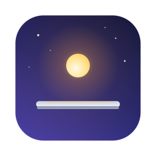
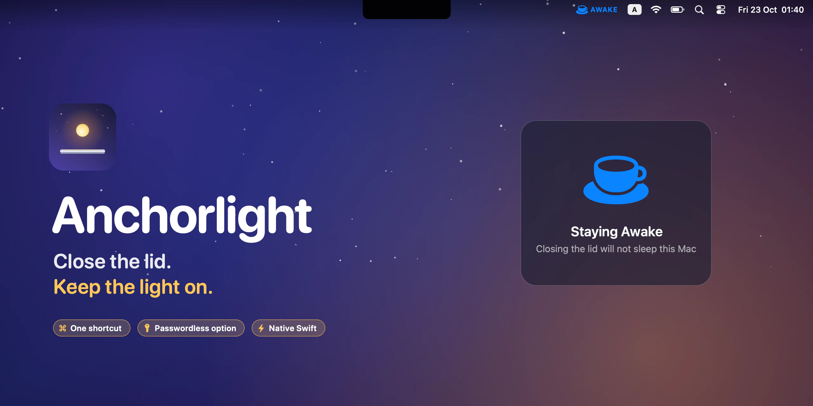
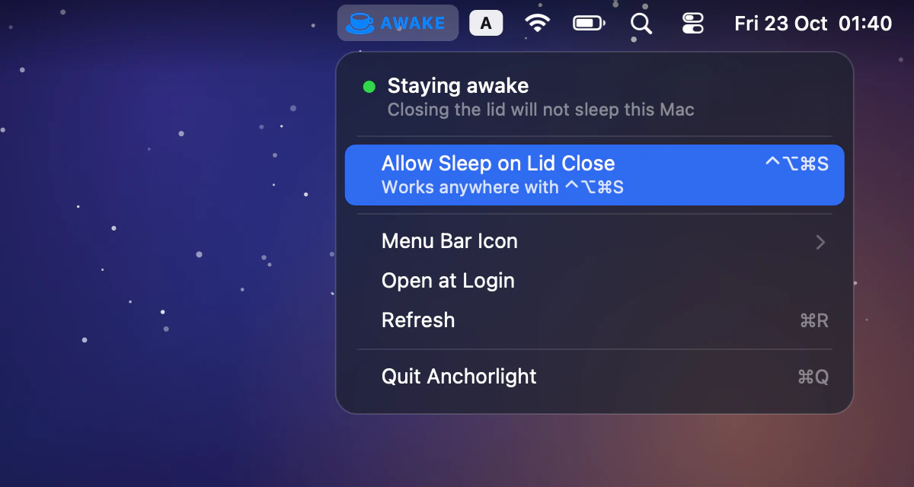
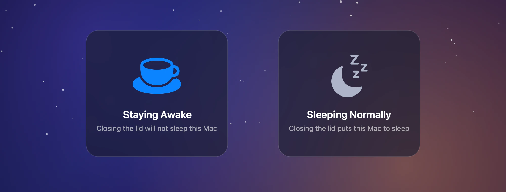
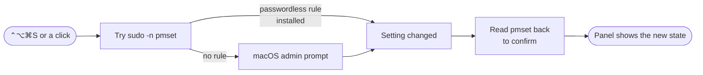

<p align="center">
  
</p>

<h1 align="center">Anchorlight</h1>

<p align="center">
  <strong>Close the lid. Keep the light on.</strong><br>
  A tiny native macOS app that keeps your Mac awake with the lid shut —<br>
  one shortcut, one glance at the menu bar, no Terminal.
</p>

<p align="center">
  <a href="https://github.com/an6122003/anchorlight/releases/latest"></a>
  
  
  
  
  <a href="LICENSE"></a>
</p>

<p align="center">
  <strong>English</strong> ·
  <a href="README.vi.md">Tiếng Việt</a> ·
  <a href="README.zh-CN.md">简体中文</a>
</p>



## Why

An anchor light is the lamp a ship keeps burning all night while it rides at anchor. Anchorlight does that for your Mac: shut the lid, and it stays on — finishing a render, a download, a long build, or serving music to the speakers across the room.

macOS will only stay awake with the lid closed in *clamshell mode*, which needs a power adapter **and** an external display. `caffeinate` and most keep-awake utilities prevent *idle* sleep, but closing the lid still puts the Mac to sleep. The setting that actually overrides lid sleep is a single command:

```bash
sudo pmset -a disablesleep 1
```

Anchorlight turns that into a switch you can flip in a second and see at a glance.

> [!WARNING]
> **A Mac that can't sleep keeps running in your bag.** With the lid shut and no airflow it can get very hot and drain its battery. Turn Anchorlight off before you pack the Mac away — the moon icon in the menu bar means it's safe.

## Features

| | |
|---|---|
| ☕️ **Impossible to miss** | A tinted cup and an **AWAKE** label while sleep is off; a plain moon when the Mac sleeps normally. |
| ⌨️ **One shortcut** | <kbd>⌃⌥⌘S</kbd> flips it from any app, and a panel confirms which state you just chose. |
| 🔑 **Passwordless, if you want** | An optional sudoers rule covers exactly the two `pmset` commands Anchorlight runs — nothing else. Without it, you get the standard macOS admin prompt. |
| ✅ **Never lies** | Every toggle re-reads `pmset` afterwards and tells you if the setting didn't actually change. The state is also re-read every 15 seconds, on wake, and whenever the menu opens. |
| 🪶 **Takes as little of the bar as you like** | Always show the icon, show it only while the Mac is being kept awake, or never show it and use the shortcut alone. |
| 🔒 **Nothing hidden** | No network access, no background helper, no kernel extension. Pure Swift and AppKit, zero dependencies. |

<p align="center">
  
</p>



## How it works

The whole job is one root-only setting, `SleepDisabled`, which Anchorlight reads with `pmset -g` and writes with `pmset -a disablesleep`. Getting root without a background daemon takes two tries:



1. **`sudo -n`** runs the command only if a passwordless rule allows it, and fails instantly — no prompt, no hang — if not.
2. Otherwise Anchorlight asks macOS for the change through the standard **administrator prompt**. Cancelling it changes nothing and raises no error.
3. Either way, it **reads the setting back** before telling you anything, so the menu bar always reflects what `pmset` really says — including changes you make from Terminal.

The shortcut uses Carbon's `RegisterEventHotKey`, so it needs no Accessibility permission.

## Install

1. Download **Anchorlight-1.0.dmg** from [Releases](https://github.com/an6122003/anchorlight/releases/latest) and drag **Anchorlight** into **Applications**.
2. Anchorlight isn't notarized yet, so macOS blocks the first launch: open **System Settings → Privacy & Security** and click **Open Anyway** — or run:
   ```bash
   xattr -dr com.apple.quarantine /Applications/Anchorlight.app
   ```
3. Launch it and press <kbd>⌃⌥⌘S</kbd>. Enter your password when macOS asks.

**Optional — skip the password prompt:**

```bash
sudo ./scripts/install-sudoers.sh            # from a clone of this repository
sudo ./scripts/install-sudoers.sh --remove   # undo it
```

This adds `/etc/sudoers.d/anchorlight-pmset`, validated with `visudo` before it's installed, granting your user `NOPASSWD` for exactly `/usr/bin/pmset -a disablesleep 0` and `… 1`. The trade-off: any process running as you could then flip lid sleep without asking. It can't run anything else.

> **Requirements:** macOS 13 Ventura or later. Universal binary for Apple Silicon and Intel.

## Using it

| To… | Do this |
|---|---|
| Keep the Mac awake with the lid closed | Press <kbd>⌃⌥⌘S</kbd>, or click the moon → **Keep Awake with Lid Closed** |
| Let it sleep normally again | Press <kbd>⌃⌥⌘S</kbd> again, or **Allow Sleep on Lid Close** |
| Free up menu bar space | **Menu Bar Icon → Show Icon Only When Awake** |
| Reach the menu with the icon hidden | Open Anchorlight again from Spotlight |
| Start it automatically | **Open at Login** |

## FAQ

<details>
<summary><b>How is this different from <code>caffeinate</code> and other keep-awake apps?</b></summary>
<br>

`caffeinate` and most keep-awake apps prevent *idle* sleep: the Mac won't doze off while it's open and unattended, but closing the lid still sleeps it unless you're in clamshell mode with a display and power attached. Some apps can go further with an extra helper; Anchorlight does only this one thing, directly — `disablesleep` overrides lid sleep itself, with no display required.
</details>

<details>
<summary><b>Does quitting Anchorlight turn it off?</b></summary>
<br>

No. `SleepDisabled` is a system setting; Anchorlight is just the switch and the indicator. If you quit it while the Mac is being kept awake, it stays awake. Turn it off first, or run `sudo pmset -a disablesleep 0`.
</details>

<details>
<summary><b>Why does it ask for my password?</b></summary>
<br>

`pmset` only changes power settings as root. Install the optional sudoers rule above to make the toggle instant.
</details>

<details>
<summary><b>I can't see the icon.</b></summary>
<br>

If your menu bar is full, macOS simply doesn't draw the icons that don't fit — on a notched MacBook they vanish behind the notch. The shortcut still works, and so does reopening Anchorlight from Spotlight. Its sibling app <a href="https://github.com/an6122003/stowaway">Stowaway</a> fixes the full-menu-bar problem for good.
</details>

## Build from source

```bash
git clone https://github.com/an6122003/anchorlight.git
cd anchorlight
./build.sh            # → build/Anchorlight.app  (host architecture)
./package.sh          # → dist/Anchorlight-1.0.dmg (universal)
```

No Xcode project, no dependencies — just the Xcode Command Line Tools. `./scripts/make-readme-art.sh` regenerates every image in this README; they're drawn in code.

| Path | |
|---|---|
| `Sources/PowerSleep.swift` | Reads `pmset -g`, writes via `sudo -n`, falls back to the admin prompt |
| `Sources/AppDelegate.swift` | Menu bar item, menu, icon modes, launch at login |
| `Sources/GlobalHotKey.swift` | The permission-free global shortcut |
| `Sources/HUD.swift` | The floating confirmation panel |
| `scripts/install-sudoers.sh` | The optional passwordless rule |

## The harbour

Anchorlight is one of three small, native Mac utilities that share a look and a habit of doing one thing well:

| | | |
|---|---|---|
|  | **[Stowaway](https://github.com/an6122003/stowaway)** | Every menu bar icon — even the ones behind the notch |
|  | **[Marina](https://github.com/an6122003/marina)** | A Dock on every display |
|  | **Anchorlight** | Close the lid, keep the light on |

## License

[MIT](LICENSE) © 2026 an6122003
