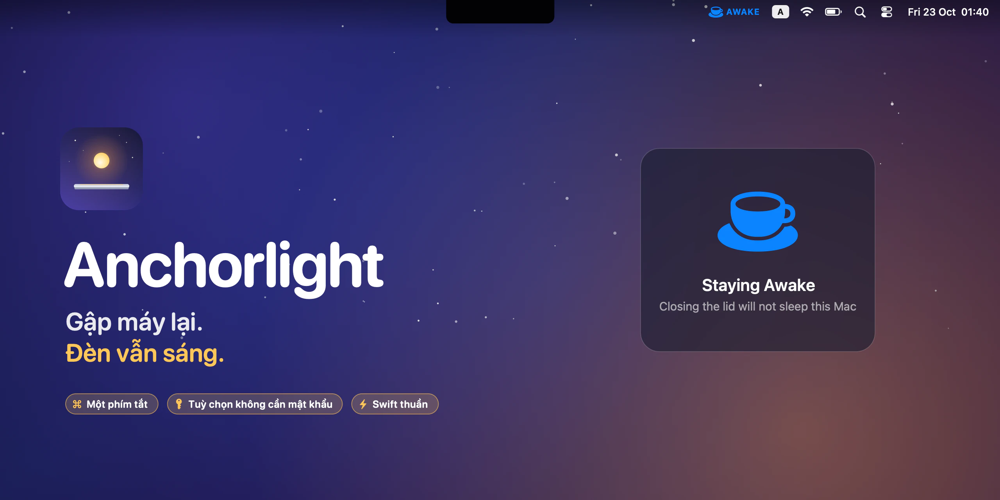
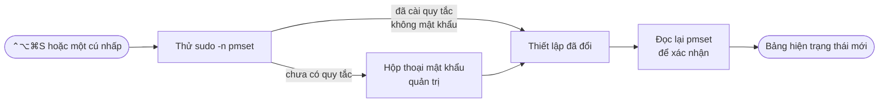

<p align="center">
  
</p>

<h1 align="center">Anchorlight</h1>

<p align="center">
  <strong>Gập máy lại. Đèn vẫn sáng.</strong><br>
  Một ứng dụng macOS nhỏ gọn, viết thuần Swift, giữ cho Mac luôn thức khi gập màn hình —<br>
  một phím tắt, nhìn thanh menu là biết, không cần mở Terminal.
</p>

<p align="center">
  <a href="https://github.com/an6122003/anchorlight/releases/latest"></a>
  
  
  
  
  <a href="LICENSE"></a>
</p>

<p align="center">
  <a href="README.md">English</a> ·
  <strong>Tiếng Việt</strong> ·
  <a href="README.zh-CN.md">简体中文</a>
</p>



## Vì sao có Anchorlight

Anchor light (đèn neo) là ngọn đèn một con tàu giữ sáng suốt đêm khi đang thả neo. Anchorlight làm điều đó cho chiếc Mac của bạn: gập máy lại, máy vẫn chạy — để render cho xong, tải nốt file, chạy một bản build dài, hay phát nhạc ra loa ở góc phòng.

macOS chỉ chịu thức khi gập máy ở *chế độ clamshell*, tức là phải cắm sạc **và** có màn hình ngoài. `caffeinate` và hầu hết các tiện ích chống ngủ chỉ ngăn máy ngủ khi *không dùng tới*, còn gập máy lại thì Mac vẫn ngủ như thường. Thiết lập thực sự vô hiệu hoá việc ngủ khi gập máy chỉ là một lệnh:

```bash
sudo pmset -a disablesleep 1
```

Anchorlight biến lệnh đó thành một công tắc bật tắt trong một giây và nhìn là biết ngay.

> [!WARNING]
> **Một chiếc Mac không thể ngủ sẽ tiếp tục chạy trong balo của bạn.** Khi gập máy mà không có chỗ thoát nhiệt, máy có thể nóng lên rất nhiều và hao pin nhanh. Hãy tắt Anchorlight trước khi cất máy đi — biểu tượng mặt trăng trên thanh menu nghĩa là đã an toàn.

## Tính năng

| | |
|---|---|
| ☕️ **Không thể nhìn nhầm** | Một tách cà phê tô màu kèm nhãn **AWAKE** khi đang tắt chế độ ngủ; một hình mặt trăng đơn giản khi Mac ngủ bình thường. |
| ⌨️ **Một phím tắt** | <kbd>⌃⌥⌘S</kbd> bật tắt từ bất kỳ ứng dụng nào, kèm một bảng nhỏ xác nhận trạng thái bạn vừa chọn. |
| 🔑 **Không cần mật khẩu, nếu bạn muốn** | Một quy tắc sudoers tuỳ chọn chỉ cho phép đúng hai lệnh `pmset` mà Anchorlight dùng — không gì khác. Nếu không cài, bạn sẽ thấy hộp thoại nhập mật khẩu quản trị quen thuộc của macOS. |
| ✅ **Không bao giờ báo sai** | Sau mỗi lần bật tắt, ứng dụng đọc lại `pmset` và báo cho bạn nếu thiết lập thực ra không thay đổi. Trạng thái cũng được đọc lại mỗi 15 giây, khi máy thức dậy, và mỗi lần mở menu. |
| 🪶 **Chiếm thanh menu ít tuỳ ý** | Luôn hiện biểu tượng, chỉ hiện khi máy đang được giữ thức, hoặc không bao giờ hiện và chỉ dùng phím tắt. |
| 🔒 **Không giấu giếm gì** | Không kết nối mạng, không có tiến trình chạy ngầm, không kernel extension. Thuần Swift và AppKit, không phụ thuộc thư viện ngoài. |

<p align="center">
  
</p>


## Cách hoạt động

Toàn bộ công việc chỉ là một thiết lập yêu cầu quyền root, `SleepDisabled`, được Anchorlight đọc bằng `pmset -g` và ghi bằng `pmset -a disablesleep`. Để có quyền root mà không cần tiến trình chạy ngầm, ứng dụng thử hai cách:



1. **`sudo -n`** chỉ chạy lệnh nếu có quy tắc không cần mật khẩu cho phép, và thất bại ngay lập tức — không hỏi, không treo — nếu không có.
2. Nếu vậy, Anchorlight xin macOS thay đổi qua **hộp thoại mật khẩu quản trị** tiêu chuẩn. Bấm huỷ thì không có gì thay đổi và cũng không báo lỗi.
3. Dù theo cách nào, ứng dụng cũng **đọc lại thiết lập** trước khi báo bất cứ điều gì, nên thanh menu luôn phản ánh đúng những gì `pmset` thực sự ghi nhận — kể cả khi bạn đổi từ Terminal.

Phím tắt dùng `RegisterEventHotKey` của Carbon nên không cần quyền Trợ năng.

## Cài đặt

1. Tải **Anchorlight-1.0.dmg** từ mục [Releases](https://github.com/an6122003/anchorlight/releases/latest) rồi kéo **Anchorlight** vào thư mục **Applications**.
2. Anchorlight chưa được Apple công chứng (notarize), nên macOS sẽ chặn lần mở đầu tiên: vào **Cài đặt hệ thống → Quyền riêng tư & Bảo mật** rồi bấm **Vẫn mở** — hoặc chạy lệnh:
   ```bash
   xattr -dr com.apple.quarantine /Applications/Anchorlight.app
   ```
3. Mở ứng dụng và nhấn <kbd>⌃⌥⌘S</kbd>. Nhập mật khẩu khi macOS hỏi.

**Tuỳ chọn — bỏ qua bước nhập mật khẩu:**

```bash
sudo ./scripts/install-sudoers.sh            # chạy trong bản clone của repo này
sudo ./scripts/install-sudoers.sh --remove   # gỡ bỏ
```

Lệnh này thêm file `/etc/sudoers.d/anchorlight-pmset` — được kiểm tra bằng `visudo` trước khi cài — cấp quyền `NOPASSWD` cho tài khoản của bạn với đúng hai lệnh `/usr/bin/pmset -a disablesleep 0` và `… 1`. Đổi lại: bất kỳ tiến trình nào chạy dưới tài khoản của bạn cũng có thể bật tắt chế độ ngủ khi gập máy mà không cần hỏi. Nó không thể chạy bất cứ lệnh nào khác.

> **Yêu cầu:** macOS 13 Ventura trở lên. Bản universal, chạy trên cả Apple Silicon lẫn Intel.

## Sử dụng

| Muốn… | Làm thế này |
|---|---|
| Giữ Mac thức khi gập máy | Nhấn <kbd>⌃⌥⌘S</kbd>, hoặc nhấp vào mặt trăng → **Keep Awake with Lid Closed** |
| Cho máy ngủ bình thường trở lại | Nhấn <kbd>⌃⌥⌘S</kbd> lần nữa, hoặc **Allow Sleep on Lid Close** |
| Tiết kiệm chỗ trên thanh menu | **Menu Bar Icon → Show Icon Only When Awake** |
| Mở menu khi đã ẩn biểu tượng | Mở lại Anchorlight từ Spotlight |
| Tự chạy khi khởi động | **Open at Login** |

## Câu hỏi thường gặp

<details>
<summary><b>Khác gì so với <code>caffeinate</code> và các ứng dụng chống ngủ khác?</b></summary>
<br>

`caffeinate` và hầu hết các ứng dụng chống ngủ chỉ ngăn máy ngủ khi *không dùng tới*: Mac sẽ không tự ngủ khi đang mở mà bạn không thao tác, nhưng gập máy lại thì vẫn ngủ, trừ khi đang ở chế độ clamshell có cắm màn hình và sạc. Một số ứng dụng làm được nhiều hơn nhờ cài thêm công cụ phụ; Anchorlight chỉ làm đúng một việc, một cách trực tiếp — `disablesleep` vô hiệu hoá chính việc ngủ khi gập máy, không cần màn hình ngoài.
</details>

<details>
<summary><b>Thoát Anchorlight thì chế độ này có tắt không?</b></summary>
<br>

Không. `SleepDisabled` là một thiết lập của hệ thống; Anchorlight chỉ là công tắc và đèn báo. Nếu bạn thoát ứng dụng khi máy đang được giữ thức, máy vẫn tiếp tục thức. Hãy tắt trước, hoặc chạy `sudo pmset -a disablesleep 0`.
</details>

<details>
<summary><b>Sao lại hỏi mật khẩu của tôi?</b></summary>
<br>

`pmset` chỉ thay đổi thiết lập nguồn với quyền root. Cài quy tắc sudoers tuỳ chọn ở trên để bật tắt tức thì.
</details>

<details>
<summary><b>Tôi không thấy biểu tượng đâu.</b></summary>
<br>

Nếu thanh menu đã đầy, macOS đơn giản là không vẽ những biểu tượng không còn chỗ — trên MacBook có tai thỏ, chúng biến mất sau tai thỏ. Phím tắt vẫn hoạt động, mở lại Anchorlight từ Spotlight cũng vậy. Ứng dụng anh em <a href="https://github.com/an6122003/stowaway">Stowaway</a> giải quyết dứt điểm chuyện thanh menu bị đầy.
</details>

## Tự build từ mã nguồn

```bash
git clone https://github.com/an6122003/anchorlight.git
cd anchorlight
./build.sh            # → build/Anchorlight.app  (kiến trúc của máy đang dùng)
./package.sh          # → dist/Anchorlight-1.0.dmg (bản universal)
```

Không cần project Xcode, không phụ thuộc thư viện ngoài — chỉ cần Xcode Command Line Tools. `./scripts/make-readme-art.sh` tạo lại toàn bộ hình ảnh trong README này; tất cả đều được vẽ bằng mã.

| Đường dẫn | |
|---|---|
| `Sources/PowerSleep.swift` | Đọc `pmset -g`, ghi qua `sudo -n`, nếu không được thì chuyển sang hộp thoại quản trị |
| `Sources/AppDelegate.swift` | Mục trên thanh menu, menu, các chế độ biểu tượng, mở khi đăng nhập |
| `Sources/GlobalHotKey.swift` | Phím tắt toàn hệ thống không cần cấp quyền |
| `Sources/HUD.swift` | Bảng xác nhận nổi |
| `scripts/install-sudoers.sh` | Quy tắc không cần mật khẩu (tuỳ chọn) |

## Bến cảng

Anchorlight là một trong ba tiện ích Mac nhỏ gọn, viết thuần Swift, cùng chung một phong cách và cùng một thói quen: làm thật tốt đúng một việc.

| | | |
|---|---|---|
|  | **[Stowaway](https://github.com/an6122003/stowaway)** | Mọi biểu tượng trên thanh menu — kể cả những cái bị tai thỏ che mất |
|  | **[Marina](https://github.com/an6122003/marina)** | Mỗi màn hình một Dock |
|  | **Anchorlight** | Gập máy lại, đèn vẫn sáng |

## Giấy phép

[MIT](LICENSE) © 2026 an6122003
