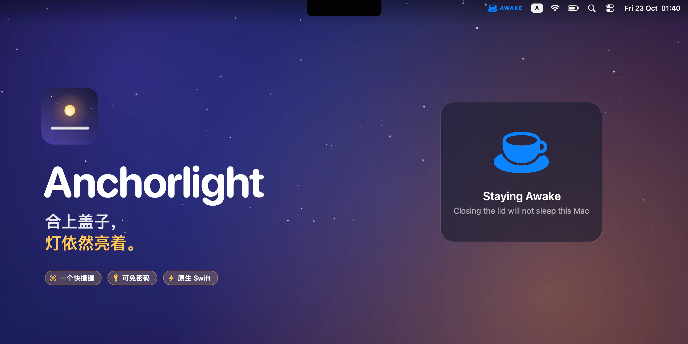
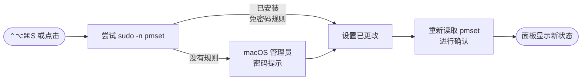

<p align="center">
  
</p>

<h1 align="center">Anchorlight</h1>

<p align="center">
  <strong>合上盖子，灯依然亮着。</strong><br>
  一个小巧的原生 macOS 应用：合上屏幕后让 Mac 保持唤醒——<br>
  一个快捷键，看一眼菜单栏就知道状态，无需打开终端。
</p>

<p align="center">
  <a href="https://github.com/an6122003/anchorlight/releases/latest"></a>
  
  
  
  
  <a href="LICENSE"></a>
</p>

<p align="center">
  <a href="README.md">English</a> ·
  <a href="README.vi.md">Tiếng Việt</a> ·
  <strong>简体中文</strong>
</p>



## 为什么需要它

锚灯（anchor light）是船只抛锚时整夜点亮的那盏灯。Anchorlight 为你的 Mac 做同样的事：合上盖子，它依然运行——把渲染跑完、把文件下完、把漫长的构建编完，或者继续把音乐送到房间另一头的音箱。

macOS 只有在*合盖模式*下才会合盖不睡，而这需要接上电源**并且**连接外接显示器。`caffeinate` 和大多数防睡眠工具只能阻止*闲置*睡眠，合上盖子 Mac 照样会睡。真正能让合盖不睡眠的设置，只是一条命令：

```bash
sudo pmset -a disablesleep 1
```

Anchorlight 把它变成一个一秒就能切换、一眼就能看清的开关。

> [!WARNING]
> **无法睡眠的 Mac 在你的背包里也会继续运行。** 合盖且没有通风时，它可能会变得非常烫，电池也会迅速耗尽。把 Mac 收起来之前，请先关闭 Anchorlight——菜单栏显示月亮图标时就是安全的。

## 功能

| | |
|---|---|
| ☕️ **绝不会看错** | 禁止睡眠时显示一个着色的杯子和 **AWAKE** 标签；正常睡眠时只显示一个普通的月亮。 |
| ⌨️ **一个快捷键** | 在任何应用中按 <kbd>⌃⌥⌘S</kbd> 即可切换，并弹出面板确认你刚刚选择的状态。 |
| 🔑 **想免密码也可以** | 可选的 sudoers 规则只放行 Anchorlight 用到的那两条 `pmset` 命令——别无其他。不安装的话，就会看到 macOS 标准的管理员密码提示。 |
| ✅ **从不误报** | 每次切换后都会重新读取 `pmset`，如果设置实际上没有变化就会告诉你。状态还会每 15 秒、唤醒时以及每次打开菜单时重新读取。 |
| 🪶 **菜单栏占用随你定** | 始终显示图标、仅在保持唤醒时显示，或者完全不显示、只用快捷键。 |
| 🔒 **没有任何隐藏的东西** | 不联网、没有后台助手进程、没有内核扩展。纯 Swift 与 AppKit 编写，零第三方依赖。 |

<p align="center">
  
</p>


## 工作原理

整个功能只围绕一个需要 root 权限的设置 `SleepDisabled`：Anchorlight 用 `pmset -g` 读取它，用 `pmset -a disablesleep` 写入它。为了在不常驻后台守护进程的情况下获得 root 权限，它会尝试两种方式：



1. **`sudo -n`** 只有在免密码规则允许时才会执行命令；如果没有规则，它会立即失败——不弹提示、不卡住。
2. 此时 Anchorlight 会通过标准的**管理员密码提示**向 macOS 请求更改。取消提示不会改变任何东西，也不会报错。
3. 无论哪种方式，它都会先**读回设置**再告诉你结果，因此菜单栏始终反映 `pmset` 的真实状态——包括你在终端里做的更改。

快捷键使用 Carbon 的 `RegisterEventHotKey`，因此不需要辅助功能权限。

## 安装

1. 从 [Releases](https://github.com/an6122003/anchorlight/releases/latest) 下载 **Anchorlight-1.0.dmg**，把 **Anchorlight** 拖进 **应用程序** 文件夹。
2. Anchorlight 尚未经过 Apple 公证，所以 macOS 会阻止首次启动：打开 **系统设置 → 隐私与安全性**，点击 **仍要打开**——或者运行：
   ```bash
   xattr -dr com.apple.quarantine /Applications/Anchorlight.app
   ```
3. 启动它并按下 <kbd>⌃⌥⌘S</kbd>。macOS 询问时输入你的密码。

**可选——跳过密码提示：**

```bash
sudo ./scripts/install-sudoers.sh            # 在本仓库的克隆目录中运行
sudo ./scripts/install-sudoers.sh --remove   # 撤销
```

它会添加 `/etc/sudoers.d/anchorlight-pmset`（安装前先用 `visudo` 校验），只为你的用户放行 `/usr/bin/pmset -a disablesleep 0` 和 `… 1` 这两条命令的 `NOPASSWD`。代价是：任何以你身份运行的进程都可以不经询问切换合盖睡眠。它无法执行任何其他命令。

> **系统要求：** macOS 13 Ventura 或更高版本。通用二进制，同时支持 Apple 芯片和 Intel。

## 使用

| 想要… | 这样做 |
|---|---|
| 合盖时保持 Mac 唤醒 | 按 <kbd>⌃⌥⌘S</kbd>，或点击月亮 → **Keep Awake with Lid Closed** |
| 恢复正常睡眠 | 再按一次 <kbd>⌃⌥⌘S</kbd>，或选择 **Allow Sleep on Lid Close** |
| 节省菜单栏空间 | **Menu Bar Icon → Show Icon Only When Awake** |
| 隐藏图标后打开菜单 | 从聚焦搜索再次打开 Anchorlight |
| 开机自动启动 | **Open at Login** |

## 常见问题

<details>
<summary><b>它和 <code>caffeinate</code> 以及其他防睡眠应用有什么不同？</b></summary>
<br>

`caffeinate` 和大多数防睡眠应用阻止的是*闲置*睡眠：Mac 打开着、无人操作时不会自己睡着，但合上盖子依然会睡，除非处于接着显示器和电源的合盖模式。有些应用借助额外的辅助工具能做得更多；Anchorlight 只做这一件事，而且直接——`disablesleep` 直接禁止合盖睡眠本身，不需要外接显示器。
</details>

<details>
<summary><b>退出 Anchorlight 会关闭它吗？</b></summary>
<br>

不会。`SleepDisabled` 是系统设置；Anchorlight 只是开关和指示灯。如果在保持唤醒时退出应用，Mac 会继续保持唤醒。请先关闭，或运行 `sudo pmset -a disablesleep 0`。
</details>

<details>
<summary><b>为什么要输入我的密码？</b></summary>
<br>

`pmset` 只能以 root 身份修改电源设置。安装上面的可选 sudoers 规则，切换就会即时生效。
</details>

<details>
<summary><b>我看不到它的图标。</b></summary>
<br>

如果菜单栏已经满了，macOS 就不会绘制放不下的图标——在带刘海的 MacBook 上，它们会消失在刘海后面。快捷键依然可用，从聚焦搜索重新打开 Anchorlight 也一样。它的姊妹应用 <a href="https://github.com/an6122003/stowaway">Stowaway</a> 可以彻底解决菜单栏塞满的问题。
</details>

## 从源码构建

```bash
git clone https://github.com/an6122003/anchorlight.git
cd anchorlight
./build.sh            # → build/Anchorlight.app  （当前机器的架构）
./package.sh          # → dist/Anchorlight-1.0.dmg （通用二进制）
```

不需要 Xcode 工程，也没有任何依赖——只要装有 Xcode 命令行工具即可。`./scripts/make-readme-art.sh` 会重新生成本 README 中的所有图片，它们全部用代码绘制。

| 路径 | |
|---|---|
| `Sources/PowerSleep.swift` | 读取 `pmset -g`，通过 `sudo -n` 写入，失败时改用管理员提示 |
| `Sources/AppDelegate.swift` | 菜单栏项目、菜单、图标模式、登录时打开 |
| `Sources/GlobalHotKey.swift` | 无需权限的全局快捷键 |
| `Sources/HUD.swift` | 浮动确认面板 |
| `scripts/install-sudoers.sh` | 可选的免密码规则 |

## 港湾

Anchorlight 是三款小巧原生 Mac 工具之一，它们风格一致，也都只把一件事做好：

| | | |
|---|---|---|
|  | **[Stowaway](https://github.com/an6122003/stowaway)** | 每一个菜单栏图标——包括被刘海挡住的那些 |
|  | **[Marina](https://github.com/an6122003/marina)** | 每块屏幕，都有程序坞 |
|  | **Anchorlight** | 合上盖子，灯依然亮着 |

## 许可证

[MIT](LICENSE) © 2026 an6122003
